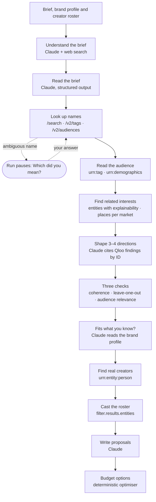

# Common Ground

**An AI creative strategist and casting agent for brand teams, built on Qloo's taste graph.**

Give Common Ground one campaign brief. It uses Qloo to find the cultural world your customers live in, then turns that into three or four creative directions. Next, it finds real creators whose audience shares each direction's taste and ranks your own creator roster the same way. Finally, it writes a priced proposal for every match. Every fact it shows traces back to the Qloo request it came from.

**[Open the live demo](https://commonground-peach.vercel.app)** and choose *See the live demo*. It opens a finished campaign in one click, with no sign-up.

Built for the [Qloo Agentic Hackathon](https://qloo.devpost.com/), from scratch, during the hackathon. The first commit is dated 28 October 2026.

## What it does

- **One brief.** Enter the product, goal, budget, markets and what you know about your customers. Each audience statement is labelled as customer research, a team belief or a guess.
- **A twelve-step research agent.** You can watch it work, with live status and a time estimate. It reads up on the brand and market on the web and matches every name to Qloo. It asks *"Which did you mean?"* only when a name is genuinely ambiguous.
- **Three or four creative directions.** Each direction includes:
  - who it speaks to and where the product fits;
  - scenes to shoot, a palette and a mood;
  - the insights behind it, each with the Qloo results it rests on;
  - what to confirm before committing.
- **Four checks per direction.**
  - Does it hang together?
  - Does it hold up if you drop one input?
  - Does it suit the stated audience?
  - Does it fit what you already know? This check reads the direction against your own research and quotes the passage when the two disagree.
- **Real creators Qloo matched to each direction.** Each one shows an Instagram handle, occupations, and the age and gender lean of their audience. One click adds a creator to your roster.
- **Your own roster.** Add creators through CSV import or by hand, with rates, availability and notes, and mark them preferred or excluded. Each creator is matched to Qloo by Instagram handle. Creators without a rate stay in, marked "Quote required".
- **Priced proposals.** Each proposal has a concept, an opening line, a shot list, deliverables, usage terms and what's still to agree. Every proposal exports as a one-page brief.
- **Budget options** built from real prices. Try another budget and they recalculate instantly.
- **Precise control.**
  - Edit a proposal; the edit is saved as a new version.
  - Ask for a simpler production.
  - Swap the creator without redoing the research.
  - Compare proposals side by side.
  - Remove an input and compare the two versions.
- **A brand profile.** Upload research once, as a PDF or text. Statements are extracted with their exact passage and page. You approve them, and then they fill in every new brief.
- **Without Qloo?** The same brief runs again without Qloo's data, and the two results are compared blind.

## Why Qloo is load-bearing

The creative directions, the evidence behind them, the checks and the casting all come from Qloo. The example campaign made 122 Qloo lookups.

| Qloo request | What Common Ground uses it for |
|---|---|
| `GET /search` | Matches the brands, artists, shows and podcasts in the brief. It accepts only one clear match. Otherwise the run pauses and asks. |
| `GET /v2/tags` | Turns interests into tags. |
| `GET /v2/audiences` | Turns audience descriptions into audience segments. |
| `/v2/insights` · `filter.type=urn:tag` | The lifestyles, aesthetics, emotional tones and hobbies that people with these tastes share. This is the raw material for the directions. |
| `/v2/insights` · `urn:demographics` | The age and gender lean of the people who like each reference and each creator. |
| `/v2/insights` · entities with `feature.explainability=true` | What else these people enjoy across music, TV, film, books, podcasts and brands, and which input led to each result. |
| `/v2/insights` · `filter.location.query` | Places in each market's city, for local shoots. |
| `/v2/insights` · `filter.results.tags` | Scores a direction's concepts against the audience inputs (relevance) and against each other (coherence). |
| `/v2/insights` · `filter.results.entities` | Ranks every creator against a direction in one request, so they're compared fairly. |
| `/v2/insights` · `filter.type=urn:entity:person` | Finds real creators and the category's own talent, such as chefs for coffee and runners for running shoes. Results are filtered by occupation tags and anchored on the brief's own brands. |
| `GET /entities` · `external.instagram.ids` | Matches imported creators to Qloo by their public handle. |

The client also implements `/v2/trending` and `/v2/analysis/compare`, but the product doesn't use them, because trend data was flat for the brands we tested.

The in-app page [How we use Qloo](https://commonground-peach.vercel.app/about/qloo) counts every lookup the example campaign made. It also traces one insight back to its exact request.

## How the agent works



**Durable runs.** The research run is a durable workflow built on the [Workflow SDK](https://github.com/vercel/workflow):

- Every step is idempotent and is retried if it fails.
- A run can be cancelled.
- A run resumes after a crash.
- A run pauses for your answer when a name is ambiguous.

Closing the browser tab doesn't stop a run.

**The model.** Every step uses Claude Haiku 5.5, with prompt caching. Effort is set per step: low for extraction and high for writing. The first step uses Anthropic's web search tool for background; nothing it finds is shown as evidence.

**Checked output.** Every model step returns structured output that is validated with Zod. When the output breaks a rule, the specific errors go back to the model and it tries again.

## Why you can trust it

- **Facts come from code, not the model.** Templates write each Qloo fact from the stored result: its rank, the query it came from and the affinity. The model only chooses which facts matter.
- **Insights must cite facts.** An insight is rejected if it contains numbers, superlatives, sales or performance predictions, or claims about individuals.
- **Scores are compared only within one lookup.** Qloo normalises affinity per request, so creators are ranked within a single request. Missing data shows as "no data", never as zero.
- **Sources stay apart.** Qloo data, customer research, team beliefs, past results and AI suggestions each carry their own label.
- **Privacy.**
  - Only public names and public handles are sent to Qloo. Contact details, rates and notes never are.
  - Qloo describes groups of people with shared tastes. Nothing here predicts what one person will do.

## Stack

| Layer | Choice |
|---|---|
| App | Next.js 16 (App Router), TypeScript, Tailwind CSS, shadcn/ui |
| Durable runs | Workflow SDK, run by Vercel in production |
| Database | Postgres through Drizzle: Neon in production, embedded PGlite locally |
| Accounts | Better Auth with organisations; `authorize()` checks every campaign, proposal and roster action |
| Model | Claude Haiku 5.5 through the Anthropic SDK, with structured output, web search and prompt caching |
| Qloo | Our own client, with typed endpoints and trimmed responses, plus a private Postgres cache. It paces requests under the per-second limit and logs every call. |
| Documents | unpdf reads uploaded research |
| Hosting | Vercel |

## Run locally

You need Node.js 22 or later, pnpm, a Qloo hackathon API key and an Anthropic API key.

```bash
pnpm install
cp .env.example .env.local   # add QLOO_API_KEY, ANTHROPIC_API_KEY, BETTER_AUTH_SECRET and DEMO_PASSWORD
pnpm db:seed                 # demo brand, fictional roster and example brand profile
pnpm db:showcase             # researches the example campaign with the real pipeline
pnpm dev
```

Then open http://localhost:3000 and choose *See the live demo*.

**Local database.** When `DATABASE_URL` is empty, the app runs embedded [PGlite](https://pglite.dev) (Postgres compiled to WebAssembly) in `./.pglite` and applies migrations automatically. PGlite allows only one process per data directory, so stop `pnpm dev` before running a seed script.

**Production.** `DATABASE_URL` points at Neon, and the Vercel build runs `pnpm db:deploy && pnpm build`. `GET /api/health` reports which database driver and workflow backend are active.

| Script | Purpose |
|---|---|
| `pnpm dev` · `pnpm build` · `pnpm start` | Run, build and serve the app |
| `pnpm test` | Unit tests: synthetic fixtures, no network |
| `pnpm test:live` | Contract tests against the live Qloo hackathon API |
| `pnpm typecheck` · `pnpm lint` | Static checks |
| `pnpm db:generate` · `pnpm db:migrate` | Drizzle migrations |
| `pnpm db:studio` · `pnpm db:reset` | Browse the database · delete the local PGlite data |
| `pnpm db:seed` | Demo accounts, the fictional 30-creator roster and the example brand profile. Safe to run again. |
| `pnpm db:showcase` | Researches the example campaign once, and skips it if it already exists |
| `pnpm db:deploy` | Migrate, seed and research the showcase (the Vercel build step) |
| `pnpm auth:generate` | Regenerate the Better Auth tables after changing auth plugins |

## Project layout

```
src/app/             Pages, server actions and dev-only API routes (Next.js App Router)
src/workflows/       The durable research workflow
src/lib/pipeline/    The twelve stages, casting rules, budget optimiser and rank-biased overlap
src/lib/claims/      Findings written from templates, claim rules and the validation loop
src/lib/qloo/        Qloo client: typed API, trimming, pacing, private cache and call log
src/lib/llm/         Claude client: structured output, web research and prompt caching
src/lib/roster/      CSV import, Qloo matching by handle and audience lean
src/lib/brand/       Brand profile: reading documents, extracting statements and approval
src/lib/proposals/   Edit, simpler version, swap and version history
src/lib/auth/        Better Auth setup and authorize() permission checks
src/db/              Drizzle schema and connection
drizzle/             SQL migrations
scripts/             Migrate, seed the demo and research the showcase
```

[PLAN.md](PLAN.md) holds the product and build plan. [RESEARCH.md](RESEARCH.md) holds the hackathon rules and notes on the Qloo API.

## Data handling

- The Qloo and Anthropic keys stay on the server. They are never sent to the browser and never committed.
- Qloo responses are cached privately in Postgres and never stored in this repository. Unit tests use synthetic fixtures, and live checks live in `*.live.test.ts`.
- Every Qloo call is logged with its parameters, status and latency. That log feeds the in-product evidence trail.

## Limitations

- If a brief describes the audience only by age, Qloo can't tell directions apart for it, and that check says "Couldn't check".
- Qloo's taste data doesn't change by city. Differences between markets come only from local places.
- Qloo can't filter people by country, so a suggested creator may work outside your market.
- Smaller creators you import may not be in Qloo. They're still cast on their past work and price.
- The demo roster's creators are fictional and labelled as such.

## License

[MIT](LICENSE)
